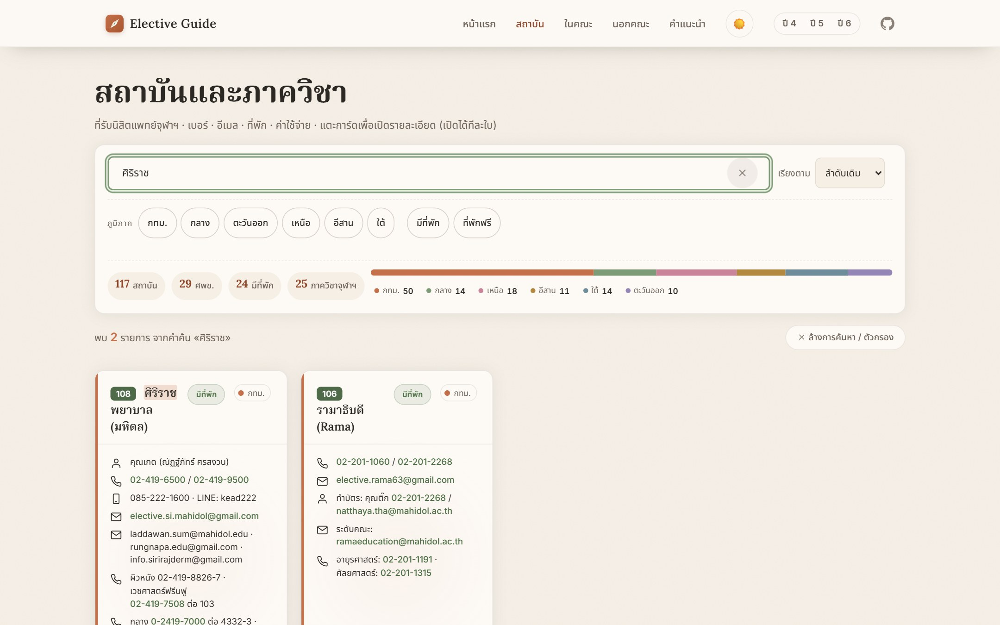

# คู่มือ Elective · นิสิตแพทย์จุฬาฯ

[](https://plub-supanut.github.io/elective-guide/)
[](https://github.com/Plub-Supanut/elective-guide/actions/workflows/sync-ssc.yml)
[](https://github.com/Plub-Supanut/elective-guide/commits/main)


เว็บรวมข้อมูลสำหรับนิสิตแพทย์จุฬาฯ ที่จะไป elective: เบอร์โทร อีเมล ผู้ประสานงาน ที่พัก ค่าใช้จ่าย
ของสถาบันและภาควิชาทุกที่ที่รับนิสิต — แยกเป็น **6 หน้า** (หน้าแรก · สถาบัน · แผนที่ · ในคณะ · นอกคณะ · คำแนะนำ)
โดยหน้า «นอกคณะ» ดึงกำหนดการกับเอกสารจากเว็บ SSCs Guide มาอัปเดตเองทุกสัปดาห์

**[เปิดเว็บไซต์ →](https://plub-supanut.github.io/elective-guide/)**


## ทำไมถึงทำเว็บนี้

ข้อมูลการติดต่อทั้งหมดอยู่ใน Google Form ซึ่งอ่านยาก และเว็บ SSC ก็ใช้ยากเหมือนกัน
เลยทำเว็บนี้ให้หาข้อมูลง่ายกว่าเดิม

## โครงเว็บ 6 หน้า

| หน้า | ไฟล์ | มีอะไร |
|---|---|---|
| หน้าแรก | `index.html` | hero · ค้นหาด่วน (กด Enter แล้วไปหน้าสถาบันพร้อมคำค้น) · การ์ดตัวเลข 4 ใบ (กดแล้วกรองเลย) · ทางลัดไปทุกหน้า |
| สถาบัน | `institutions.html` | ค้นหา + ตัวกรอง + เรียง + **แท็บหมวด 8 หมวด** + การ์ด 117 ใบ |
| แผนที่ | `map.html` | แผนที่ SVG เต็มพื้นที่ พร้อม legend / explorer กทม. / เปรียบเทียบ |
| ในคณะ | `inside.html` | ช่องทางแสดงความจำนง · **ตารางสถานะรายชั้นปี** · ข้อมูลรายวิชา 6 ชีต · กรณีใช้รายวิชากลาง · ติดต่อ |
| นอกคณะ | `outside.html` | กำหนดการ SSCs 4–6 · หลักเกณฑ์/เอกสาร PDF · สถานะรายชั้นปี · ติดต่อ (ดึงจากต้นฉบับอัตโนมัติ) |
| คำแนะนำ | `tips.html` | สิ่งที่ต้องเตรียมก่อนไป elective |

เมนู/ฟุตเตอร์/หัวหน้า ทุกหน้าสร้างจากที่เดียวด้วย `node tools/build-shell.mjs`
(แก้เมนูที่เดียวแล้วรันคำสั่งนี้ — มี `--check` ให้ CI ตรวจว่าไม่มีหน้าไหนเมนูเพี้ยน)

**ลิงก์เก่ายังใช้ได้** — ลิงก์แบบ `#ssc`, `#map`, `#institutions`, `#chula`, `#tips`
จะถูกพาไปหน้าที่ถูกต้องให้อัตโนมัติ ไม่ต้องมีใครมาแก้ลิงก์ที่แชร์กันไปแล้ว

## ในเว็บมีอะไร

| ส่วน | จำนวน | ตัวอย่าง |
|---|---:|---|
| การ์ดสถาบัน/ภาควิชาทั้งหมด | 117 | ดูได้จากตัวเลขบนหน้าแรก |
| ภาควิชาและหน่วยงานในจุฬาฯ | 25 | ภาควิชากายวิภาคศาสตร์, ศูนย์ชีวาภิบาล |
| คณะแพทยศาสตร์มหาวิทยาลัยต่าง ๆ | 20 | ศิริราช, รามาธิบดี, ขอนแก่น, เชียงใหม่ |
| โรงพยาบาลและศูนย์เฉพาะทาง | 39 | ราชวิถี, สถาบันประสาทวิทยา, สถาบันมะเร็ง |
| ศูนย์แพทยศาสตร์ศึกษาชั้นคลินิก (ศพช.) และโรงพยาบาลภูมิภาค | 36 | ขอนแก่น, หาดใหญ่, ลำปาง, อุ้มผาง |
| ที่ที่มีที่พักให้ | 24 | ดูจาก badge «มีที่พัก» บนการ์ด |

การ์ดแต่ละใบมี: ผู้ประสานงาน · เบอร์โทร · อีเมล · ที่อยู่หรืออาคาร · ข้อมูลที่พัก ·
ค่าใช้จ่ายและค่ามัดจำ · หมายเหตุเฉพาะที่ เช่น รอบที่ไม่สะดวก หรือเงื่อนไขการเลือกสาย



## ฟีเจอร์

**ค้นหาได้ทุกแบบที่คนพิมพ์จริง**
พิมพ์ไทย อังกฤษ หรือตัวย่อ ก็เจอเรื่องเดียวกัน เช่น `ศิริราช` = `Siriraj` = `รพ.ศิริราช`,
`ขอนแก่น` = `KKU` = `มข` = `Khon Kaen`, `หู คอ จมูก` = `ENT` = `โสต ศอ นาสิก`
และตัดคำเต็มกับคำย่อให้เท่ากันก่อนเทียบ พิมพ์ `รพ.ชลบุรี` ก็เจอ `โรงพยาบาลชลบุรี`

**การ์ดหุบไว้เสมอ จนกว่าคุณจะกดเปิดเอง**
การ์ดทุกใบเริ่มที่สถานะหุบ (เปิดได้ทีละใบ · กดซ้ำหรือกด Esc เพื่อหุบ)
ถ้าคำค้นไปตรงกับข้อความที่อยู่ในส่วนที่หุบอยู่ **การ์ดจะไม่กางให้เอง** แต่ขึ้นแถวล่างว่า
«▾ ตรงใน «รายละเอียดที่พัก» · กดเพื่อดู» พร้อมไฮไลต์คำนั้นไว้แล้วในส่วนที่ซ่อน
ถ้าตรงเพราะเป็นคำพ้อง ก็ไฮไลต์คำที่ตรงจริงในหน้าให้ (พิมพ์ `Siriraj` แล้วเห็น `ศิริราช` ถูกไฮไลต์)

**การ์ดสถิติ 4 ใบกดได้** กดแล้วกรองรายชื่อให้ทันที (ทั้งหมด / ภูมิภาคและ ศพช. / มีที่พัก / ภาควิชาจุฬาฯ)

**ตัวกรองเลือกได้หลายเงื่อนไข** แบ่งเป็น 3 กลุ่ม: ประเภท (จุฬาฯ / มหาวิทยาลัย / โรงพยาบาล / ศพช. /
รพ.จังหวัด / เอกชน) · ภูมิภาค (กทม. / กลาง / เหนือ / อีสาน / ใต้) · อื่น ๆ (มีที่พัก / ที่พักฟรี)
เลือกหลายอันในกลุ่มเดียวกันได้ (หรือ) และข้ามกลุ่มได้ (และ) เช่น «ศพช. + มีที่พัก + เหนือ»
พร้อมเรียงผลลัพธ์ตามรหัส / ชื่อ ก-ฮ / มีที่พักก่อน

**ลิงก์แชร์ได้** เงื่อนไขที่เลือกอยู่ถูกเก็บใน URL เช่น `?f=cpird,dormitory&sort=name`
ส่งลิงก์ให้เพื่อนเปิดแล้วเห็นผลเดียวกัน ไม่ต้องมีบัญชีหรือติดตั้งอะไร

**ส่วน «นอกคณะ»** รวมช่องทางยื่นความจำนง สถานะรายชั้นปี กำหนดการส่ง หลักเกณฑ์และเอกสาร PDF
กับช่องทางติดต่ออาจารย์ผู้ดูแล ไว้ในที่เดียว และอัปเดตจากเว็บต้นฉบับอัตโนมัติ

**แผนที่สถาบัน** แผนที่ประเทศไทยแบบ SVG หมุดสีตามภาค — ภาคแต่ละภาคมี «แผ่น» เป็นเส้นขอบจังหวัดจริง
ชี้ที่แผ่นแล้วทั้งแผ่นยกขึ้น (เงา + สว่างขึ้น + ป้ายชื่อภาคขยาย) ส่วนภาคอื่นจางลง · กดที่แผ่นเพื่อกรองรายการด้านล่าง

- **ซูม/แพน** ไม่มีปุ่มบนจอ ใช้ท่าทางล้วน — คอม: ล้อเมาส์ (ซูมเข้าหาตำแหน่งเคอร์เซอร์) · ลาก · ดับเบิลคลิก ·
  แทร็กแพดหยิกสองนิ้ว · คีย์บอร์ด ลูกศร/บวกลบ/ศูนย์ (เพื่อการเข้าถึง)
- มือถือ/แท็บเลต: **นิ้วเดียวเลื่อนหน้าเว็บตามปกติ · สองนิ้วซูม/แพนแผนที่** (ไม่แย่งการเลื่อนหน้าจอ)
- ลากที่ระดับเต็มประเทศจะยืดได้เล็กน้อยแล้วสปริงกลับ (ให้รู้ว่าลากได้) · ลากเลยขอบมีขอบเขตกันหลงทาง
- ชี้ที่จุด → การ์ดข้อมูลย่อขึ้นข้างแผนที่ (ไม่ทับแผนที่) · คลิกที่จุด → ซูมเข้าหาจุดนั้น + การ์ดเต็ม
  โดย**หน้าเว็บไม่เลื่อน** — จะย้ายไปการ์ดในรายการก็ต่อเมื่อกดปุ่ม «ไปที่การ์ดเต็มในรายการ» เอง
- คลิกพื้นที่ว่าง = ปิดการ์ด / ย้อนกลับมาที่มุมเต็มประเทศ
- ภาควิชาจุฬาฯ 25 แห่งรวมเป็น **จุดเดียว** («รพ.จุฬาฯ · 25 ภาควิชา») กดแล้วเปิด**แผนผังอาคาร** isometric
  5 อาคาร วางจุดภาควิชาตามอาคาร+ชั้นที่ระบุในแบบฟอร์มต้นฉบับ (14 แห่งที่ฟอร์มไม่ระบุอาคาร แยกเป็นชิปให้กดดู)
- ภาค = กลุ่มจังหวัดที่คำนวณจากหมุดจริงของแต่ละภาค (จังหวัดไหนมีหมุดภาคไหนมากสุด ก็อยู่ภาคนั้น)
  จังหวัดที่ไม่มีหมุดใช้จังหวัดใกล้สุด · ป้ายชื่อภาควางที่จุดกลางของหมุดในภาคนั้น

**อื่น ๆ** เบอร์โทรกับอีเมลกดได้จริง · การ์ดในแถวเดียวกันสูงเท่ากัน · ลิงก์ที่ต้องล็อกอิน CU account
ติดป้าย 🔒 ให้รู้ก่อนกด · ใช้คีย์บอร์ดได้ทั้งเว็บ · เคารพ `prefers-reduced-motion` ของระบบ
· แถบความคืบหน้าการอ่านด้านบน · เมนูบนไฮไลต์ตามส่วนที่อ่านอยู่

## ไฟล์ในโปรเจกต์

| ไฟล์ | บรรทัด | ทำอะไร |
|---|---:|---|
| `index.html` | ~250 | หน้าแรก: hero · ค้นหาด่วน · การ์ดตัวเลข · ทางลัดไปทุกหน้า |
| `institutions.html` | ~5,900 | หน้าสถาบัน: ค้นหา ตัวกรอง แท็บหมวด และการ์ด 117 ใบ |
| `map.html` | ~230 | หน้าแผนที่ (โหลด `map-data.js` + `map.js` เมื่อจำเป็น) |
| `inside.html` | ~330 | หน้า «ในคณะ» — ตารางสถานะรายชั้นปี ข้อมูลรายวิชา 6 ชีต และช่องทางติดต่อ |
| `outside.html` | ~250 | หน้า «นอกคณะ» — ส่วนที่ sync จากเว็บ SSCs Guide |
| `tips.html` | ~130 | หน้า «ก่อนไป elective» |
| `ui.js` | ~110 | พฤติกรรมร่วมของทุกหน้า: fade-up เงาแถบเมนู anchor นุ่ม ปุ่มขึ้นบน tidy ข้อความ |
| `app.js` | ~630 | เฉพาะหน้าสถาบัน: ค้นหา ตัวกรอง แท็บหมวด กาง-หับการ์ด (หุบเสมอจนผู้ใช้กด) |
| `style.css` | ~2,790 | สไตล์ทั้งหมด (โทน sand / sage / terracotta) + ชั้น page shell |
| `premium.css` | ~230 | ชั้นตกแต่งเพิ่มเติม (ใช้ต่อจาก style.css) |
| `aliases.js` | ~130 | ชื่อพ้องสำหรับค้นหา ทั้งไทย อังกฤษ และตัวย่อ |
| `map.js` | ~620 | แผนที่ SVG: ซูม/แพนด้วยท่าทาง แผ่นภาค เส้นทางจากคณะฯ แผนผังอาคารจุฬาฯ และการ์ดข้อมูล |
| `map-data.js` | สร้างอัตโนมัติ | เส้นขอบจังหวัดและภาค (ย่อแล้ว) + ป้ายภาค + พิกัดสถาบัน 117 แห่ง |
| `hero-bg.js` | ~150 | ฉากหลัง hero: จุดและเส้นทางจากคณะฯ สู่ที่หมาย (canvas 2D) |
| `flair.js` | ~120 | แถบความคืบหน้า ตัวเลขวิ่ง สปอตไลต์ตามเมาส์ และเมนูมือถือ |
| `icons.js` | ~120 | แทนอีโมจิด้วยไอคอน SVG ที่คมขึ้น |
| `sync-ssc.mjs` | ~840 | ดึงข้อมูลจากเว็บ SSCs Guide มาสร้างหน้า «นอกคณะ» + «ในคณะ» (ใช้ `fetch` ล้วน) |
| `tools/ssc-source.mjs` | ~250 | ตัวอ่านหน้า Google Sites: ดึง HTML → โทเคน → วันที่ไทย/ไฟล์ Drive |
| `data/ssc-state.json` | | สถานะข้อมูลรอบล่าสุด (ใช้เทียบว่าอะไรเปลี่ยน) |
| `docs/ssc-history.md` | | ประวัติการเปลี่ยนข้อมูล — สร้างจาก `npm run sync` |
| `tools/build-shell.mjs` | ~230 | เติม head / nav / footer ให้ตรงกันทั้ง 6 หน้า (มี `--check`) |
| `tools/build-map.mjs` | ~110 | สร้าง `map-data.js` ใหม่ (ดูหัวข้อ «แผนที่» ด้านล่าง) |
| `tools/map-geocode.json` | | แคชพิกัดจาก OpenStreetMap กันยิงซ้ำ |
| `tools/chula-campus.json` | | อาคาร/ชั้นของภาควิชาจุฬาฯ (สกัดจากแบบฟอร์มต้นฉบับ) |
| `.github/workflows/sync-ssc.yml` | | ให้ GitHub รัน sync วันละ 2 ครั้ง (08:00 / 20:00 เวลาไทย) |
| `QA-REPORT.md` | ~230 | บันทึกผลตรวจเว็บและข้อมูล 3 รอบ |
| `package.json` | | คำสั่ง npm (ไม่มี dependency แล้ว) |

ไม่มี build step ตอนเปิดเว็บ ไม่มี framework ไม่มี dependency ฝั่งหน้าเว็บ เปิด `index.html` ตรง ๆ ได้เลย
(สคริปต์ build-shell ใช้เฉพาะตอน «แก้เมนู/หัวหน้า» ซึ่งไม่บ่อย)

## ลองในเครื่อง

```bash
git clone https://github.com/Plub-Supanut/elective-guide.git
cd elective-guide
python -m http.server 8765      # แล้วเปิด http://127.0.0.1:8765
```

สคริปต์ sync ใช้ Node 20 ขึ้นไป — **ไม่ต้อง `npm install`** เพราะใช้ `fetch` ในตัว Node
ไม่ใช้ Chrome/puppeteer แล้ว (หน้า Google Sites ส่งเนื้อหามาใน HTML ตั้งแต่แรก)

## แก้เมนู / เพิ่มหน้าใหม่ ทำยังไง

เมนู ฟุตเตอร์ และส่วน `<head>` ของทุกหน้าอยู่ใน `tools/build-shell.mjs` ที่เดียว
เพิ่มหน้าใหม่ = เพิ่มรายการใน `PAGES` ของไฟล์นั้น แล้วสร้างไฟล์หน้าเปล่าให้มี marker 4 กรอบ:

```html
<!-- SHELL:HEAD:START -->   <!-- SHELL:HEAD:END -->
<!-- SHELL:NAV:START -->    <!-- SHELL:NAV:END -->
<!-- SHELL:FOOTER:START --> <!-- SHELL:FOOTER:END -->
<!-- SHELL:SCRIPTS:START --> <!-- SHELL:SCRIPTS:END -->
```

แล้วรัน

```bash
node tools/build-shell.mjs          # เติมเปลือกหน้าให้ตรงกันทุกหน้า
node tools/build-shell.mjs --check  # ตรวจว่าไม่มีหน้าไหนหลุด (exit 2 = มี)
```

## หน้า «นอกคณะ» / «ในคณะ» อัปเดตยังไง

เนื้อหาส่วนเหล่านี้อยู่ในกรอบ marker — **ห้ามแก้ด้วยมือ** เพราะสคริปต์จะเขียนทับ

| หน้า | marker |
|---|---|
| `outside.html` | `<!-- SSC:AUTO:START --> … <!-- SSC:AUTO:END -->` + `<!-- SSC:DATA-HASH:… -->` |
| `inside.html` | `<!-- SSC:INSIDE:START --> … <!-- SSC:INSIDE:END -->` + `<!-- SSC:INSIDE-HASH:… -->` |

```html
<!-- SSC:AUTO:START -->
   ... สร้างจากสคริปต์ ห้ามแก้ด้วยมือ ...
<!-- SSC:AUTO:END -->
<!-- SSC:DATA-HASH:xxxxxxxxxxxx -->
```

สคริปต์อ่านข้อมูลจากเว็บต้นฉบับ คำนวณ hash แล้วเทียบกับ hash ที่ฝังไว้ในไฟล์
ถ้าไม่ตรงจึงเขียนทับ ถ้าตรงก็ไม่แตะไฟล์เลย — และจำ `data/ssc-state.json` ไว้เทียบรอบก่อน

```bash
npm run sync              # ดึงข้อมูลใหม่ อัปเดตทั้ง 2 หน้า ถ้ามีอะไรเปลี่ยน
npm run sync:check        # แค่ตรวจว่ามีอะไรเปลี่ยนไหม (exit 2 = มี)
npm run sync:print        # ดู HTML ที่จะได้ โดยไม่แตะไฟล์
npm run sync:inside       # เฉพาะหน้า «ในคณะ»
npm run sync:outside      # เฉพาะหน้า «นอกคณะ»
node sync-ssc.mjs --force # สร้างใหม่จากเทมเพลต แม้ข้อมูลไม่เปลี่ยน (ใช้ตอนแก้ข้อความ/เลย์เอาต์)
```

สิ่งที่ดึงมาอัตโนมัติ:

- **นอกคณะ**: กำหนดการส่งแบบแสดงความจำนง · สถานะรายชั้นปี · เอกสาร PDF หลักเกณฑ์ ·
  ฟอร์มและรายชื่อ MOU · ช่องทางติดต่อ
- **ในคณะ**: กลุ่มการแสดงความจำนงรายชั้นปี (พร้อมวันหมดเขตที่แปลงเป็น ISO) · หมายเหตุ
  «เฉพาะนิสิตที่สนใจ» / «เลื่อน + เหตุผล» · ชีตข้อมูลรายวิชาแยกชุด «รอบแรก/คงเหลือ» · CUCIS ·
  กรณีใช้รายวิชากลาง + ไฟล์ PDF · ช่องทางติดต่อ
- **ป้าย 🔒** ตรวจจริงทุกลิงก์ (ไฟล์ Drive ลองดาวน์โหลดจริง — ถ้าได้ PDF แปลว่าเปิดสาธารณะ)

**รู้ทันการเปลี่ยนของต้นฉบับ** — ทุกครั้งที่ sync ถ้าพบว่ามีอะไรเพิ่ม/หาย/เปลี่ยนวัน
จะเขียนบรรทัดใหม่ลง `docs/ssc-history.md` และ CI จะเปิด/อัปเดต issue ให้ตรวจ
เช่น วันที่ «ชั้นปีที่ 4» ประกาศกลุ่มขึ้นมา จะมีทั้งการ์ดใหม่บนหน้าเว็บและประวัติในไฟล์

ถ้าเว็บต้นฉบับเปลี่ยนโครงสร้างจนดึงข้อมูลไม่ครบ สคริปต์จะ**ไม่แก้ไฟล์** และคืน exit code 3
workflow จะขึ้น error ให้รู้ว่าต้องไปแก้ `sync-ssc.mjs` ไม่ใช่ปล่อยให้เว็บเพี้ยน

GitHub Action รัน**วันละ 2 ครั้ง** (08:00 / 20:00 เวลาไทย) ถ้าข้อมูลเปลี่ยนจะ commit ให้เอง
หรือจะกดรันมือที่แท็บ Actions ก็ได้ (มีตัวเลือก `force`)

## แผนที่ สร้างยังไง

แผนที่ใช้ข้อมูล 2 ก้อน: **เส้นขอบจังหวัด** (ย่อด้วย Douglas-Peucker ให้เหลือ ~2,200 จุด จาก 26,700)
และ **พิกัดสถาบัน 117 แห่ง** จาก OpenStreetMap/Nominatim ซึ่งแคชไว้แล้วใน `tools/map-geocode.json`

```bash
node tools/build-map.mjs      # เขียน map-data.js ใหม่ (ใช้แคชเดิม ไม่ยิงถาม OSM ซ้ำ)
```

- `src: 'province-centroid'` หรือ `'approximate'` = หาพิกัดตรงไม่ได้ ใช้จุดกลางจังหวัด/ภาคแทน
  หมุดพวกนี้จะแสดงเป็นวงกลมกลวงและขึ้นคำว่า «ตำแหน่งโดยประมาณ» (ตอนนี้ 8 จาก 117 จุด)
- ภาควิชาในคณะแพทยศาสตร์ จุฬาฯ ใช้พิกัดเดียวกันทั้ง 25 แห่ง จึงกระจายออกเป็นวงเล็ก ๆ รอบคณะฯ
  เพื่อให้กดแยกได้ (ระบุไว้ในหมายเหตุใต้แผนที่แล้ว)
- ถ้าเพิ่ม/ลบสถาบัน ให้ลบรายการนั้นออกจากแคชแล้วรันสคริปต์ใหม่ มันจะไปถาม OSM ให้เอง (1 ครั้ง/วินาที)

## อยากแก้ข้อมูล ทำยังไง

**เพิ่มคำค้นหรือชื่อเรียกใหม่** แก้ที่ `aliases.js` ที่เดียว เพิ่มบรรทัดตามรูปแบบนี้:

```js
['ศิริราช', 'Siriraj', 'รพ.ศิริราช'],   // พิมพ์คำไหนในกลุ่ม ก็เจอการ์ดที่เขียนด้วยคำอื่นในกลุ่ม
```

**เพิ่มหรือแก้การ์ดสถาบัน** แก้ที่ `institutions.html` โดยคัดลอกการ์ดเดิมมาวาง แล้วแก้ `data-tags`
(คำที่ใช้ค้น ควรมีชื่อไทย ชื่ออังกฤษ และตัวย่อ) ชื่อการ์ด และแถวข้อมูลข้างใน

**แก้ข้อความในหน้า «นอกคณะ» / «ในคณะ»** อย่าแก้ในไฟล์ HTML เพราะจะถูกเขียนทับ
ให้แก้ที่เทมเพลตใน `sync-ssc.mjs` แล้วรัน `node sync-ssc.mjs --force`

## แหล่งข้อมูล

| ข้อมูล | ต้นทาง |
|---|---|
| เบอร์โทร อีเมล ผู้ประสานงาน ที่พัก ค่าใช้จ่าย | [Google Form รวมโดยฝ่ายวิชาการ](https://docs.google.com/forms/d/10MmEj9L_zBfZ-vFX4IkEbARIFToITw4I9rcYhMeB-9Y/viewform) |
| กำหนดการ เอกสาร หลักเกณฑ์ รายชื่อ MOU | [SSCs Guide](https://sites.google.com/chula.md/ssc/outside) |
| ช่องทางยื่นความจำนงและสถานะรายชั้นปี | [SSCs Application](https://portal.md.chula.ac.th/SSCsapplication) (ใช้ CU account) |

## หมายเหตุ

ข้อมูลในเว็บมาจากปีการศึกษา 2565–2567 ถ้าจะไปจริงควรเช็คกับสถาบันอีกครั้ง
เบอร์และผู้ประสานงานเปลี่ยนได้ตลอด โดยเฉพาะช่วงต้นเทอม

เจอข้อมูลผิด หรือมีที่ที่ยังไม่มีในเว็บ เปิด issue หรือส่ง pull request มาได้เลย
หรือทักมาบอกก็ได้ ยินดีแก้ให้
