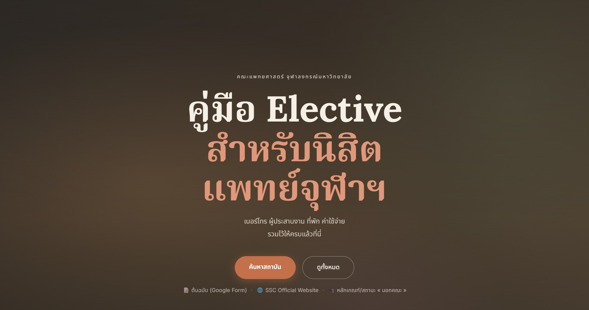
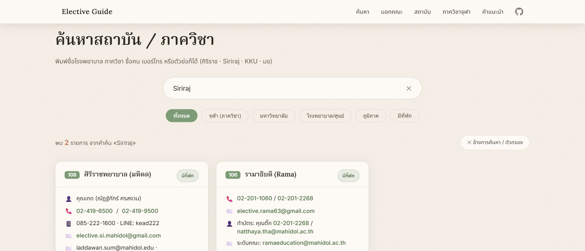

# คู่มือ Elective · นิสิตแพทย์จุฬาฯ

[](https://plub-supanut.github.io/elective-guide/)
[](https://github.com/Plub-Supanut/elective-guide/actions/workflows/sync-ssc.yml)
[](https://github.com/Plub-Supanut/elective-guide/commits/main)


เว็บรวมข้อมูลสำหรับนิสิตแพทย์จุฬาฯ ที่จะไป elective: เบอร์โทร อีเมล ผู้ประสานงาน ที่พัก ค่าใช้จ่าย
ของสถาบันและภาควิชาทุกที่ที่รับนิสิต พร้อมส่วน «รายวิชาเลือก นอกคณะ» ที่ดึงกำหนดการกับเอกสาร
จากเว็บ SSCs Guide มาอัปเดตเองทุกสัปดาห์

**[เปิดเว็บไซต์ →](https://plub-supanut.github.io/elective-guide/)**



## ทำไมถึงทำเว็บนี้

ข้อมูลการติดต่อทั้งหมดอยู่ใน Google Form ซึ่งอ่านยาก และเว็บ SSC ก็ใช้ยากเหมือนกัน
เลยทำเว็บนี้ให้หาข้อมูลง่ายกว่าเดิม

## ในเว็บมีอะไร

| ส่วน | จำนวน | ตัวอย่าง |
|---|---:|---|
| การ์ดสถาบัน/ภาควิชาทั้งหมด | 117 | ดูได้จากตัวเลขบนหน้าแรก |
| ภาควิชาและหน่วยงานในจุฬาฯ | 25 | ภาควิชากายวิภาคศาสตร์, ศูนย์ชีวาภิบาล |
| คณะแพทยศาสตร์มหาวิทยาลัยต่าง ๆ | 20 | ศิริราช, รามาธิบดี, ขอนแก่น, เชียงใหม่ |
| โรงพยาบาลและศูนย์เฉพาะทาง | 39 | ราชวิถี, สถาบันประสาทวิทยา, สถาบันมะเร็ง |
| ศูนย์แพทยศาสตร์ศึกษาชั้นคลินิก (ศพช.) และโรงพยาบาลภูมิภาค | 36 | ขอนแก่น, หาดใหญ่, ลำปาง, อุ้มผาง |
| ที่ที่มีที่พักให้ | 24 | ดูจาก badge «มีที่พัก» บนการ์ด |

การ์ดแต่ละใบมี: ผู้ประสานงาน · เบอร์โทร · อีเมล · ที่อยู่หรืออาคาร · ข้อมูลที่พัก ·
ค่าใช้จ่ายและค่ามัดจำ · หมายเหตุเฉพาะที่ เช่น รอบที่ไม่สะดวก หรือเงื่อนไขการเลือกสาย



## ฟีเจอร์

**ค้นหาได้ทุกแบบที่คนพิมพ์จริง**
พิมพ์ไทย อังกฤษ หรือตัวย่อ ก็เจอเรื่องเดียวกัน เช่น `ศิริราช` = `Siriraj` = `รพ.ศิริราช`,
`ขอนแก่น` = `KKU` = `มข` = `Khon Kaen`, `หู คอ จมูก` = `ENT` = `โสต ศอ นาสิก`
และตัดคำเต็มกับคำย่อให้เท่ากันก่อนเทียบ พิมพ์ `รพ.ชลบุรี` ก็เจอ `โรงพยาบาลชลบุรี`

คำที่ตรงกับ**ส่วนที่ยังไม่กาง** จะกางการ์ดให้เองพร้อมไฮไลต์ เพื่อให้เห็นว่าตรงตรงไหน
ถ้าตรงเพราะเป็นคำพ้อง ก็ไฮไลต์คำที่ตรงจริงในหน้าให้ (พิมพ์ `Siriraj` แล้วเห็น `ศิริราช` ถูกไฮไลต์)

**การ์ดสถิติ 4 ใบกดได้** กดแล้วกรองรายชื่อให้ทันที (ทั้งหมด / ภูมิภาคและ ศพช. / มีที่พัก / ภาควิชาจุฬาฯ)

**ตัวกรองเลือกได้หลายเงื่อนไข** แบ่งเป็น 3 กลุ่ม: ประเภท (จุฬาฯ / มหาวิทยาลัย / โรงพยาบาล / ศพช. /
รพ.จังหวัด / เอกชน) · ภูมิภาค (กทม. / กลาง / เหนือ / อีสาน / ใต้) · อื่น ๆ (มีที่พัก / ที่พักฟรี)
เลือกหลายอันในกลุ่มเดียวกันได้ (หรือ) และข้ามกลุ่มได้ (และ) เช่น «ศพช. + มีที่พัก + เหนือ»
พร้อมเรียงผลลัพธ์ตามรหัส / ชื่อ ก-ฮ / มีที่พักก่อน

**ลิงก์แชร์ได้** เงื่อนไขที่เลือกอยู่ถูกเก็บใน URL เช่น `?f=cpird,dormitory&sort=name`
ส่งลิงก์ให้เพื่อนเปิดแล้วเห็นผลเดียวกัน ไม่ต้องมีบัญชีหรือติดตั้งอะไร

**ส่วน «นอกคณะ»** รวมช่องทางยื่นความจำนง สถานะรายชั้นปี กำหนดการส่ง หลักเกณฑ์และเอกสาร PDF
กับช่องทางติดต่ออาจารย์ผู้ดูแล ไว้ในที่เดียว และอัปเดตจากเว็บต้นฉบับอัตโนมัติ

**แผนที่สถาบัน** หมุด 117 จุดบนแผนที่ประเทศไทย (พิกัดจริงจาก OpenStreetMap) แยกสีตามภาค
ชี้ที่หมุดเพื่อดูชื่อ พร้อมเส้นทางโค้งจากคณะฯ ไปที่หมายนั้น กดที่หมุดเพื่อกระโดดไปการ์ดของสถาบัน
กดที่ภาคเพื่อกรองรายการด้านล่าง

**อื่น ๆ** เบอร์โทรกับอีเมลกดได้จริง · การ์ดในแถวเดียวกันสูงเท่ากัน · ลิงก์ที่ต้องล็อกอิน CU account
ติดป้าย 🔒 ให้รู้ก่อนกด · ใช้คีย์บอร์ดได้ทั้งเว็บ · เคารพ `prefers-reduced-motion` ของระบบ
· แถบความคืบหน้าการอ่านด้านบน · เมนูบนไฮไลต์ตามส่วนที่อ่านอยู่

## ไฟล์ในโปรเจกต์

| ไฟล์ | บรรทัด | ทำอะไร |
|---|---:|---|
| `index.html` | ~5,950 | หน้าเว็บทั้งหมด รวมการ์ด 117 ใบ และส่วน «นอกคณะ» |
| `style.css` | ~1,500 | สไตล์ทั้งหมด (โทน sand / sage / terracotta) |
| `app.js` | ~460 | ค้นหา ตัวกรอง กาง-พับการ์ด และทำให้การ์ดสูงเท่ากัน |
| `aliases.js` | ~130 | ชื่อพ้องสำหรับค้นหา ทั้งไทย อังกฤษ และตัวย่อ |
| `map.js` | ~230 | วาดแผนที่ประเทศไทย หมุด 117 จุด และการกดกรองตามภาค |
| `map-data.js` | สร้างอัตโนมัติ | เส้นขอบจังหวัด (ย่อแล้ว) + พิกัดสถาบัน 117 แห่ง |
| `hero-bg.js` | ~150 | ฉากหลัง hero: จุดและเส้นทางจากคณะฯ สู่ที่หมาย (canvas 2D) |
| `flair.js` | ~120 | แถบความคืบหน้า ตัวเลขวิ่ง สปอตไลต์ตามเมาส์ และเมนูตามส่วน |
| `sync-ssc.mjs` | ~510 | ดึงข้อมูลจากเว็บ SSCs Guide มาสร้างส่วน «นอกคณะ» |
| `tools/build-map.mjs` | ~110 | สร้าง `map-data.js` ใหม่ (ดูหัวข้อ «แผนที่» ด้านล่าง) |
| `tools/map-geocode.json` | | แคชพิกัดจาก OpenStreetMap กันยิงซ้ำ |
| `.github/workflows/sync-ssc.yml` | | ให้ GitHub รัน sync ทุกวันจันทร์ 08:00 น. |
| `QA-REPORT.md` | ~230 | บันทึกผลตรวจเว็บและข้อมูล 3 รอบ |
| `package.json` | | คำสั่ง npm และ dependency ของสคริปต์ sync |

ไม่มี build step ไม่มี framework ไม่มี dependency ฝั่งหน้าเว็บ เปิด `index.html` ตรง ๆ ได้เลย
(ไฟล์ที่เว็บโหลดรวมกัน ~444 KB หรือ ~85 KB หลังบีบอัด)

## ลองในเครื่อง

```bash
git clone https://github.com/Plub-Supanut/elective-guide.git
cd elective-guide
python -m http.server 8765      # แล้วเปิด http://127.0.0.1:8765
```

สคริปต์ sync ต้องใช้ Node 20 ขึ้นไป และใช้ Chrome ที่ติดตั้งในเครื่อง (ผ่าน `puppeteer-core`)

```bash
npm install                     # ครั้งแรกครั้งเดียว
```

## ส่วน «นอกคณะ» อัปเดตยังไง

เนื้อหาส่วนนี้อยู่ในกรอบ marker ใน `index.html`:

```html
<!-- SSC:AUTO:START -->
   ... สร้างจากสคริปต์ ห้ามแก้ด้วยมือ ...
<!-- SSC:AUTO:END -->
<!-- SSC:DATA-HASH:xxxxxxxxxxxx -->
```

สคริปต์อ่านข้อมูลจากเว็บต้นฉบับ คำนวณ hash แล้วเทียบกับ hash ที่ฝังไว้ในไฟล์
ถ้าไม่ตรงจึงเขียนทับ ถ้าตรงก็ไม่แตะไฟล์เลย

```bash
npm run sync          # ดึงข้อมูลใหม่ เขียน index.html ถ้ามีอะไรเปลี่ยน
npm run sync:check    # แค่ตรวจว่ามีอะไรเปลี่ยนไหม (exit 2 = มี)
npm run sync:print    # ดู HTML ที่จะได้ โดยไม่แตะไฟล์
node sync-ssc.mjs --force   # สร้างใหม่จากเทมเพลต แม้ข้อมูลไม่เปลี่ยน (ใช้ตอนแก้ข้อความหรือเลย์เอาต์)
```

สิ่งที่ดึงมาอัตโนมัติ: กำหนดการส่งแบบแสดงความจำนง · ลิงก์สถานะรายชั้นปี · เอกสาร PDF หลักเกณฑ์ ·
ฟอร์มและรายชื่อ MOU · ช่องทางติดต่อ · และตรวจจริงว่าลิงก์ไหนเปิดได้เฉพาะ CU account เพื่อติดป้าย 🔒

ถ้าเว็บต้นฉบับเปลี่ยนโครงสร้างจนดึงข้อมูลไม่ครบ สคริปต์จะ**ไม่แก้ไฟล์** และคืน exit code 3
workflow จะขึ้น error ให้รู้ว่าต้องไปแก้ `sync-ssc.mjs` ไม่ใช่ปล่อยให้เว็บเพี้ยน

GitHub Action รันทุกวันจันทร์ 08:00 น. เวลาไทย ถ้าข้อมูลเปลี่ยนจะ commit ให้เอง
หรือจะกดรันมือที่แท็บ Actions ก็ได้

## แผนที่ สร้างยังไง

แผนที่ใช้ข้อมูล 2 ก้อน: **เส้นขอบจังหวัด** (ย่อด้วย Douglas-Peucker ให้เหลือ ~2,200 จุด จาก 26,700)
และ **พิกัดสถาบัน 117 แห่ง** จาก OpenStreetMap/Nominatim ซึ่งแคชไว้แล้วใน `tools/map-geocode.json`

```bash
node tools/build-map.mjs      # เขียน map-data.js ใหม่ (ใช้แคชเดิม ไม่ยิงถาม OSM ซ้ำ)
```

- `src: 'province-centroid'` หรือ `'approximate'` = หาพิกัดตรงไม่ได้ ใช้จุดกลางจังหวัด/ภาคแทน
  หมุดพวกนี้จะแสดงเป็นวงกลมกลวงและขึ้นคำว่า «ตำแหน่งโดยประมาณ» (ตอนนี้ 8 จาก 117 จุด)
- ภาควิชาในคณะแพทยศาสตร์ จุฬาฯ ใช้พิกัดเดียวกันทั้ง 25 แห่ง จึงกระจายออกเป็นวงเล็ก ๆ รอบคณะฯ
  เพื่อให้กดแยกได้ (ระบุไว้ในหมายเหตุใต้แผนที่แล้ว)
- ถ้าเพิ่ม/ลบสถาบัน ให้ลบรายการนั้นออกจากแคชแล้วรันสคริปต์ใหม่ มันจะไปถาม OSM ให้เอง (1 ครั้ง/วินาที)

## อยากแก้ข้อมูล ทำยังไง

**เพิ่มคำค้นหรือชื่อเรียกใหม่** แก้ที่ `aliases.js` ที่เดียว เพิ่มบรรทัดตามรูปแบบนี้:

```js
['ศิริราช', 'Siriraj', 'รพ.ศิริราช'],   // พิมพ์คำไหนในกลุ่ม ก็เจอการ์ดที่เขียนด้วยคำอื่นในกลุ่ม
```

**เพิ่มหรือแก้การ์ดสถาบัน** แก้ที่ `index.html` โดยคัดลอกการ์ดเดิมมาวาง แล้วแก้ `data-tags`
(คำที่ใช้ค้น ควรมีชื่อไทย ชื่ออังกฤษ และตัวย่อ) ชื่อการ์ด และแถวข้อมูลข้างใน

**แก้ข้อความในส่วน «นอกคณะ»** อย่าแก้ใน `index.html` เพราะจะถูกเขียนทับ ให้แก้ที่เทมเพลตใน
`sync-ssc.mjs` แล้วรัน `node sync-ssc.mjs --force`

## แหล่งข้อมูล

| ข้อมูล | ต้นทาง |
|---|---|
| เบอร์โทร อีเมล ผู้ประสานงาน ที่พัก ค่าใช้จ่าย | [Google Form รวมโดยฝ่ายวิชาการ](https://docs.google.com/forms/d/10MmEj9L_zBfZ-vFX4IkEbARIFToITw4I9rcYhMeB-9Y/viewform) |
| กำหนดการ เอกสาร หลักเกณฑ์ รายชื่อ MOU | [SSCs Guide](https://sites.google.com/chula.md/ssc/outside) |
| ช่องทางยื่นความจำนงและสถานะรายชั้นปี | [SSCs Application](https://portal.md.chula.ac.th/SSCsapplication) (ใช้ CU account) |

## หมายเหตุ

ข้อมูลในเว็บมาจากปีการศึกษา 2565–2567 ถ้าจะไปจริงควรเช็คกับสถาบันอีกครั้ง
เบอร์และผู้ประสานงานเปลี่ยนได้ตลอด โดยเฉพาะช่วงต้นเทอม

เจอข้อมูลผิด หรือมีที่ที่ยังไม่มีในเว็บ เปิด issue หรือส่ง pull request มาได้เลย
หรือทักมาบอกก็ได้ ยินดีแก้ให้
